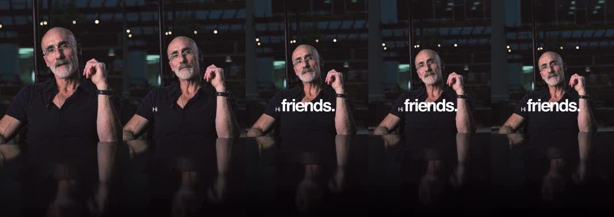

# v01_s01 · 01 Texto en pantalla (captions) · 0.0–1.0s (calidad 4)

- **Guion:** Hi friends,
- **Qué se ve:** A-roll plano medio-abierto: Arthur sentado en una mesa negra brillante, set nocturno de oficina con bokeh de luces cálidas al fondo y reflejo en la mesa. Caption 'Hi friends.'
- **Diseño:** 'friends.' bold sans apretada (tipo Helvetica/Inter Display Bold, tracking negativo), blanco #FFFFFF, ~8 % del alto; 'Hi' sans regular diminuta pegada a la izquierda en la línea base. Bloque centrado a ~48 % del alto (centro vertical, sobre el pecho).
- **Efectos:** Grade frío-oscuro (#130F12/#1D242B), viñeta natural, bokeh fuera de foco; sin textura añadida.
- **Animación:** Corte seco al primer frame; caption aparece con pop rápido (≈0.15 s, escala 105→100 % + fade). Sensación seca, directa.
- **Por qué aquí:** Hook: cara visible (ojos en tercio superior) + saludo directo que crea conexión personal desde el frame 0.
