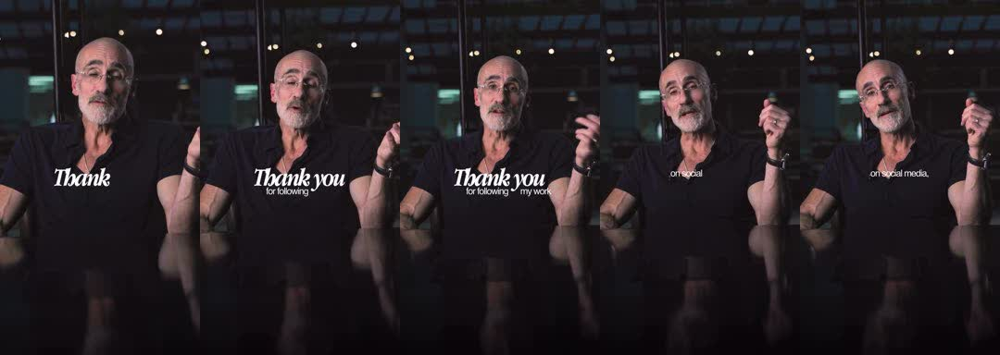

# v01_s08 · 01 Texto en pantalla (captions) · 9.6–11.9s (calidad 3)

- **Guion:** Thank you for following my work. I'm social media,
- **Qué se ve:** A-roll plano medio-corto de Arthur hablando. Caption 'Thank you / for following my work' y luego palabras sueltas pequeñas ('on').
- **Diseño:** 'Thank you' serif itálica bold blanca grande centrada (~48 % alto); 'for following' / 'my work' sans pequeña debajo a izquierda y derecha.
- **Efectos:** Grade oscuro del set, bokeh.
- **Animación:** Punch-in con corte seco al cambiar de frase (MS → MCU); caption pop seco.
- **Por qué aquí:** Gratitud directa a cámara = conexión; la cara refuerza la sinceridad.
