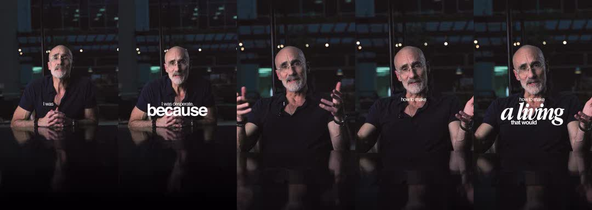

# v01_s24 · 01 Texto en pantalla (captions) · 41.5–45.2s (calidad 3)

- **Guion:** desperate because I didn't know how to make a living that would really
- **Qué se ve:** A-roll plano medio. Caption 'I was desperate. / because' y luego 'how to' pequeño.
- **Diseño:** 'because' bold sans apretada blanca grande centrada ~52 %; 'I was desperate.' sans pequeña encima.
- **Efectos:** Grade oscuro.
- **Animación:** Corte seco entre MS/MCU; pop seco.
- **Por qué aquí:** Emoción negativa contada a cámara: cercanía y sinceridad.
