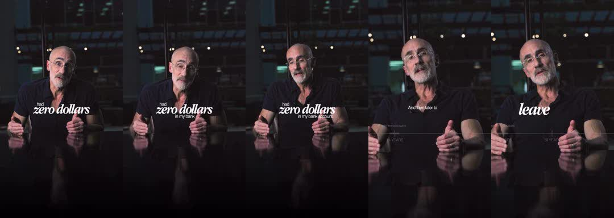

# v01_s34 · 01 Texto en pantalla (captions) · 63.1–67.0s (calidad 4)

- **Guion:** dollars in my bank account, and then later I actually left music
- **Qué se ve:** A-roll plano medio con gesto de pulgares. Caption 'had / zero dollars / in my', luego 'leave'. Al final aparece tenue la timeline encima.
- **Diseño:** 'zero dollars' serif itálica bold blanca grande; 'leave' serif itálica; contexto sans pequeña. Centro ~52 %.
- **Efectos:** Grade oscuro; al final timeline semitransparente superpuesta.
- **Animación:** Cortes secos; la timeline hace fade-in como transición hacia la escena siguiente (≈0.5 s).
- **Por qué aquí:** Cifra emocional ('cero dólares') dicha a cámara, máxima vulnerabilidad.
