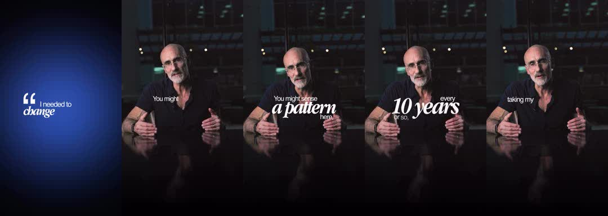

# v01_s43 · 01 Texto en pantalla (captions) · 85.3–89.5s (calidad 4)

- **Guion:** Again, you might sense a pattern here, every 10 years or so taking my whole
- **Qué se ve:** A-roll plano medio. Caption 'You' y luego 'You might sense / a pattern / here,'.
- **Diseño:** 'a pattern' serif itálica bold blanca grande centrada ~50 %; contexto sans pequeña arriba-izquierda / abajo-derecha.
- **Efectos:** Grade oscuro.
- **Animación:** Corte seco; write-on por palabra del contexto + pop.
- **Por qué aquí:** Momento de reflexión/tesis: la cara da autoridad a la lección.
