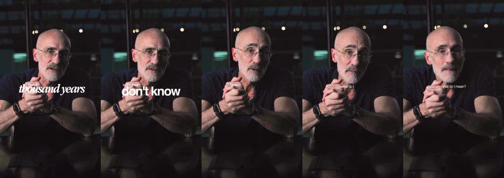

# v01_s50 · 01 Texto en pantalla (captions) · 104.5–108.6s (calidad 3)

- **Guion:** years when they don't know what to do. You don't want to see my position, what do I mean?
- **Qué se ve:** A-roll primer plano frontal. Captions 'when they / don't know / what to' y 'Now when I say / my position,'.
- **Diseño:** 'don't know' y 'my position,' bold sans apretada blanca grande; contexto sans pequeña.
- **Efectos:** Grade oscuro.
- **Animación:** Cortes secos; pop.
- **Por qué aquí:** Construye suspense antes de la revelación ('soy católico').
