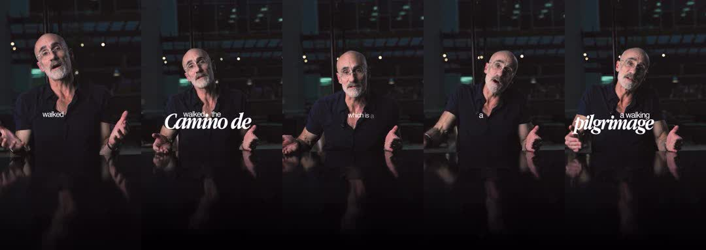

# v01_s54 · 01 Texto en pantalla (captions) · 112.4–116.5s (calidad 4)

- **Guion:** Walk the Camino de Santiago, which is a pilgrimage, a walking pilgrimage,
- **Qué se ve:** A-roll plano medio-abierto con gestos. Captions 'walked the / Camino', 'which is a / pilgrimage,', 'a walking / pilgrimage'.
- **Diseño:** 'Camino' serif itálica bold; 'pilgrimage,' primero bold sans y luego 'pilgrimage' en serif itálica (misma palabra, dos tratamientos). Centro ~48 %.
- **Efectos:** Grade oscuro.
- **Animación:** Cortes secos entre ángulos; pop por frase.
- **Por qué aquí:** Repetición con variación tipográfica: mantiene el interés cuando el guion repite la palabra.
