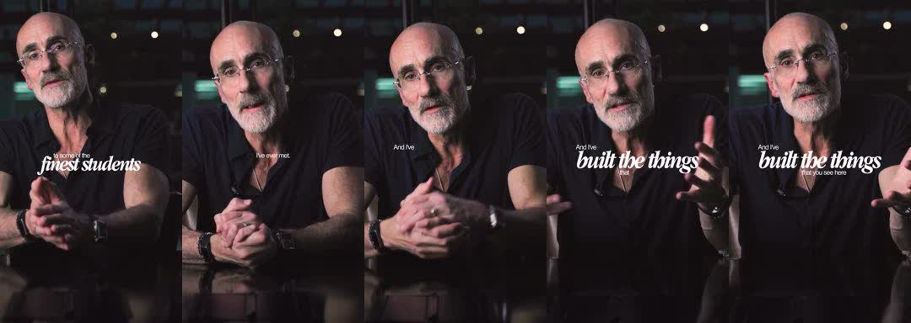

# v01_s61 · 01 Texto en pantalla (captions) · 133.5–137.8s (calidad 4)

- **Guion:** students I've ever met. And I've built the things that you see here today,
- **Qué se ve:** A-roll plano medio-corto con manos juntas. Captions 'I've ever', 'And I've / built', 'And I've / built the things / that you see'.
- **Diseño:** 'built' y luego 'built the things' serif itálica bold blanca grande; contexto sans pequeña.
- **Efectos:** Grade oscuro.
- **Animación:** La frase se amplía palabra a palabra (build-up del mismo caption); cortes secos.
- **Por qué aquí:** Anuncia el producto/obra antes de mostrarlo.
