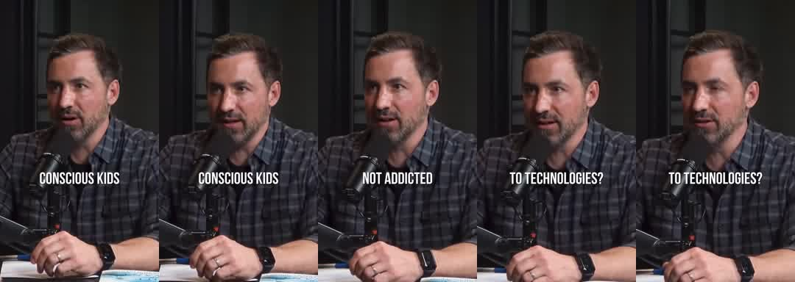

# v02_s02 · 01 Texto en pantalla (captions) · 2.9–5.9s (calidad 3)

- **Guion:** conscious kids that are not addicted to technologies?
- **Qué se ve:** Host a pantalla completa en plano medio-corto con micro, mesa con papeles. Captions 'NOT ADDICTED', 'CONSCIOUS KIDS', 'TO TECHNOLOGIES?'.
- **Diseño:** Sans condensada bold MAYÚSCULAS blanca centrada a ~63 % del alto (bajo la barbilla), 2 palabras por línea.
- **Efectos:** Grade cálido, fondo desenfocado oscuro.
- **Animación:** Corte seco desde el split; captions por bloques secos.
- **Por qué aquí:** Termina la pregunta con el que la formula a cámara completa: foco en el problema (niños + tecnología).
