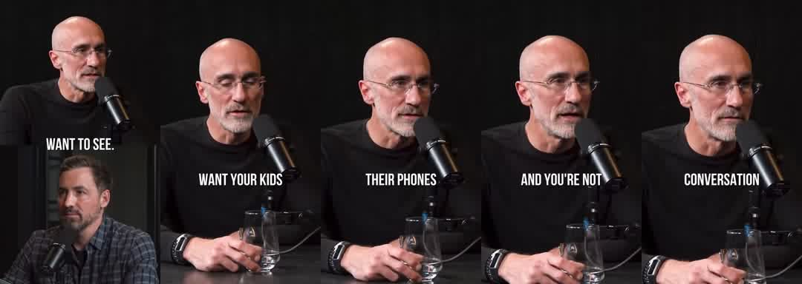

# v02_s06 · 01 Texto en pantalla (captions) · 10.0–17.5s (calidad 2)

- **Guion:** you want to see. If you don't want your kids to be screwing around with their phones at dinner, you put your phone away and you're not looking at it and you're having a conversation
- **Qué se ve:** Arthur plano medio-corto 3/4, mano en el vaso. Captions 'IF YOU DON'T', 'TO BE SCREWING', 'AT DINNER,', 'AND YOU'RE NOT', 'CONVERSATION'.
- **Diseño:** MAYÚSCULAS condensadas blancas ~63 % alto, 1–2 palabras.
- **Efectos:** Fondo negro.
- **Animación:** Plano sostenido (≈7 s) con micro-cortes de encuadre; captions rápidos.
- **Por qué aquí:** Ejemplo concreto contado a cámara: los captions sostienen la atención en un plano largo.
