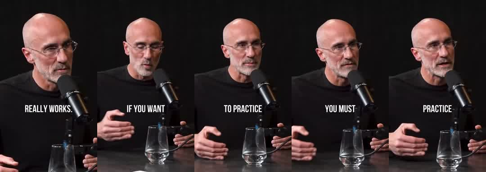

# v02_s09 · 01 Texto en pantalla (captions) · 20.5–23.5s (calidad 2)

- **Guion:** really works. If you want your kids to practice the faith, you must practice
- **Qué se ve:** Arthur plano medio-corto con gesto de manos abiertas. Captions 'YOUR KIDS', 'PRACTICE'.
- **Diseño:** MAYÚSCULAS condensadas blancas ~63 % alto.
- **Efectos:** Fondo negro.
- **Animación:** Corte seco; captions por bloques.
- **Por qué aquí:** Segundo ejemplo (fe) con gesto: ritmo de lista.
