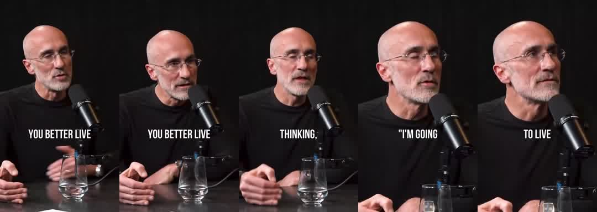

# v02_s14 · 01 Texto en pantalla (captions) · 33.1–36.0s (calidad 3)

- **Guion:** You better live thinking, I'm going to live
- **Qué se ve:** Corte a plano medio frontal más abierto de Arthur con gesto de mano. Captions 'YOU BETTER LIVE', '"I'M GOING'.
- **Diseño:** MAYÚSCULAS condensadas blancas ~63 % alto; comillas tipográficas abren la cita.
- **Efectos:** Fondo negro.
- **Animación:** Corte seco a plano abierto (pull-out) para la frase final.
- **Por qué aquí:** Abre la cita-moraleja: el plano abierto marca 'cierre'.
