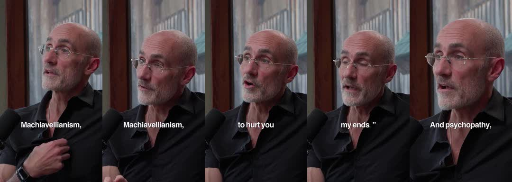

# v05_s03 · 01 Texto en pantalla (captions) · 12.7–17.0s (calidad 3)

- **Guion:** Machiavellianism, which is I'm willing to hurt you to serve my ends.
- **Qué se ve:** Primer plano 3/4 de Arthur con la mano en el pecho. Captions 'Machiavellianism,', '"I'm', 'to serve'.
- **Diseño:** Caption sans semibold blanca ~68 % alto; comillas tipográficas al citar la voz del manipulador.
- **Efectos:** Grade natural desaturado.
- **Animación:** Corte seco al CU; captions bloque.
- **Por qué aquí:** Segundo rasgo: el gesto de mano en el pecho actúa la cita en primera persona.
