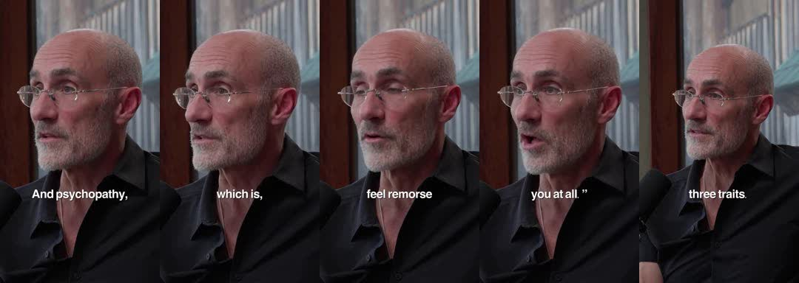

# v05_s04 · 01 Texto en pantalla (captions) · 17.0–22.5s (calidad 2)

- **Guion:** And psychopathy, psychopathic traits, which is if I hurt you, I don't feel remorse or empathy for you at all. Those are the three traits. And when
- **Qué se ve:** Primer plano 3/4 de Arthur. Captions 'And psychopathy,', '"If I', 'or empathy for', 'Those are the'.
- **Diseño:** Igual sistema ~68 % alto.
- **Efectos:** Grade natural.
- **Animación:** Plano sostenido con micro-reencuadres; captions bloque.
- **Por qué aquí:** Tercer rasgo y cierre de la lista sin cortar para no romper la enumeración.
