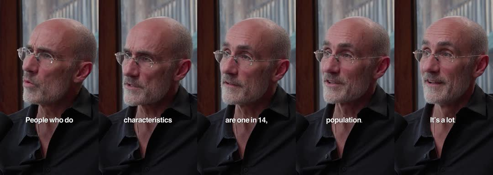

# v05_s06 · 01 Texto en pantalla (captions) · 26.5–33.1s (calidad 3)

- **Guion:** who do fulfill these characteristics are one in 14 is 7% of the population. It's a lot. That would say that's
- **Qué se ve:** Primer plano 3/4. Captions 'fulfill these', 'are one in 14,', 'it's 7% of the', 'It's a lot.'
- **Diseño:** Igual sistema; la cifra va en el caption normal, sin gráfico ni destacado.
- **Efectos:** Grade natural.
- **Animación:** Plano sostenido; captions bloque.
- **Por qué aquí:** Dato estadístico dicho a cámara (oportunidad de graph_stats no aprovechada).
