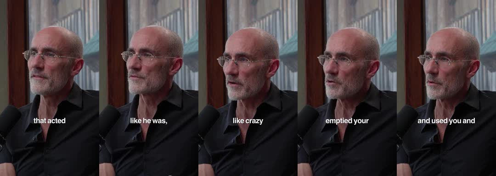

# v05_s09 · 01 Texto en pantalla (captions) · 44.3–50.5s (calidad 3)

- **Guion:** that acted like he was, like a love bomb to you like crazy. And then he emptied your bank account and used you and abandoned you.
- **Qué se ve:** Primer plano 3/4 de Arthur. Captions 'like he was,', 'like crazy', 'emptied your', 'and used you and', 'abandoned you,'.
- **Diseño:** Caption ~68 % alto.
- **Efectos:** Grade natural.
- **Animación:** Corte seco a CU; plano sostenido.
- **Por qué aquí:** El ejemplo emocional (love bombing, robo) se cuenta en primer plano para intensidad.
