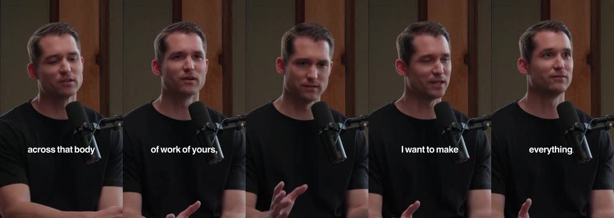

# v05_s13 · 01 Texto en pantalla (captions) · 65.5–75.3s (calidad 3)

- **Guion:** When I came across that body of work of yours, I had to go for a walk of like, I wanna make sure that I'm doing everything. (If you're worried about it,) you're not.
- **Qué se ve:** Primer plano frontal del host (camiseta negra, micro, fondo de madera cálido) hablando con gestos; al final la respuesta de Arthur ('You're not') sobre su plano.
- **Diseño:** Caption sans semibold blanca ~68 % alto.
- **Efectos:** Grade cálido marrón.
- **Animación:** Corte seco a contraplano; plano sostenido ~10 s.
- **Por qué aquí:** Reacción personal del host = momento de identificación del espectador ('¿seré yo?').
