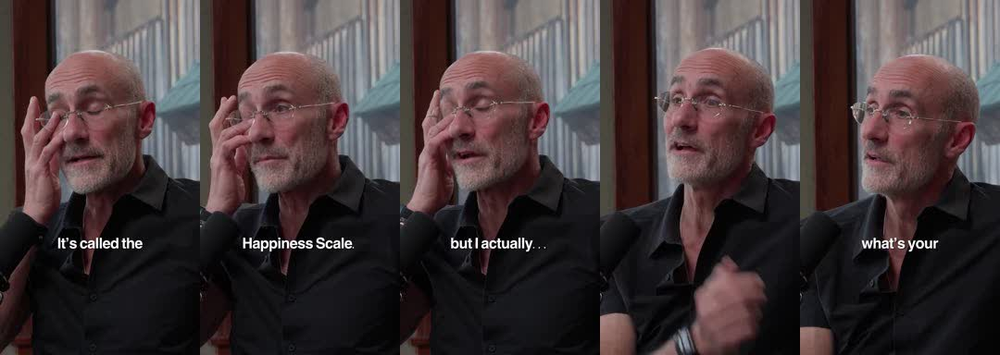

# v05_s16 · 01 Texto en pantalla (captions) · 85.9–88.4s (calidad 3)

- **Guion:** Let's call the happiness scale. But I also have a... Okay, I'm telling what's your
- **Qué se ve:** Primer plano de Arthur frotándose el ojo bajo las gafas, luego mano en la barbilla. Captions 'It's called the', 'but I actually...'.
- **Diseño:** Caption ~68 % alto; puntos suspensivos espaciados.
- **Efectos:** Grade natural.
- **Animación:** Cortes secos entre dos CU.
- **Por qué aquí:** Momento humano espontáneo (duda) que da autenticidad.
