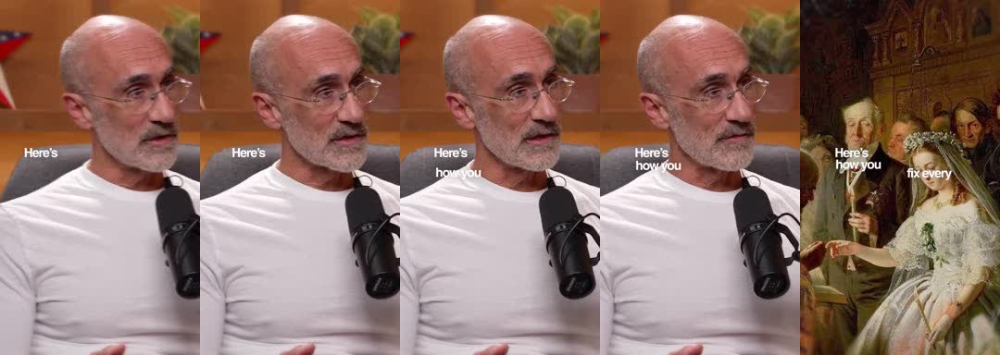

# v06_s01 · 01 Texto en pantalla (captions) · 0.0–0.5s (calidad 3)

- **Guion:** Here's how you
- **Qué se ve:** A-roll: Arthur Brooks en plano medio-corto, camiseta blanca, micro negro de brazo, fondo de estudio de madera cálida con planta y bandera.
- **Diseño:** Caption sans bold (Helvetica/Inter bold) blanca pequeña, dos palabras escalonadas ('Here's' / 'how you') en el tercio medio-izquierdo a la altura del pecho.
- **Efectos:** Ninguno; gradación cálida natural del estudio.
- **Animación:** Write-on por palabra, pop+fade muy breve (~0.1 s). Corte seco a pintura a los 0.47 s.
- **Por qué aquí:** Hook: cara del speaker apenas medio segundo para establecer quién habla; enseguida se pasa a imagen.
