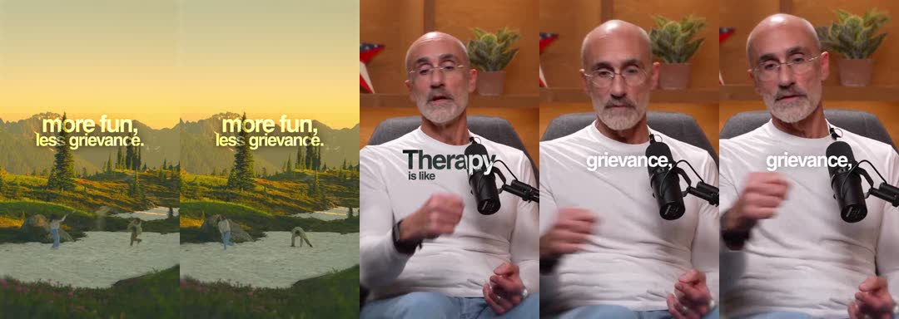

# v06_s07 · 01 Texto en pantalla (captions) · 6.8–9.7s (calidad 4)

- **Guion:** Therapy is like grievance, grievance, grievance.
- **Qué se ve:** A-roll plano medio; el speaker cuenta con la mano.
- **Diseño:** 'Therapy' sans bold grande en GRIS OSCURO/negro sobre la camiseta blanca (contraste invertido), 'is like' pequeña; luego 'grievance,' sans bold blanca grande. Altura del pecho, el micro tapa parte del texto (texto detrás del micro).
- **Efectos:** Texto colocado detrás del micrófono (máscara/rotoscopia).
- **Animación:** Pop por palabra; 'grievance,' se repite 3 veces reemplazándose (mismo lugar) al ritmo de la voz.
- **Por qué aquí:** Momento de opinión/humor: cara del speaker; el color oscuro del texto se adapta al fondo blanco de la camiseta para legibilidad.
