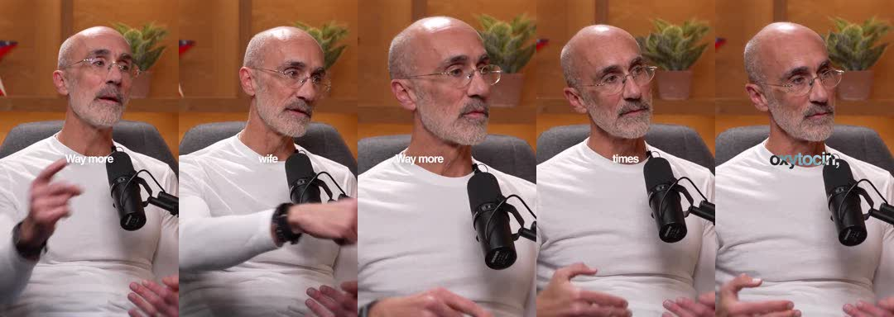

# v06_s20 · 01 Texto en pantalla (captions) · 28.7–34.3s (calidad 3)

- **Guion:** Way more important for your wife than his for you. Way more important because she gets three times as much oxytocin,
- **Qué se ve:** A-roll plano medio-corto con gestos.
- **Diseño:** Sans bold blanca pequeña 1–3 palabras; 'oxytocin,' más grande con letras que se colorean (teal) al escribirse. Micro tapa parte del texto.
- **Efectos:** Texto detrás del micro.
- **Animación:** Write-on por palabra; en 'oxytocin' revelado letra a letra con color.
- **Por qué aquí:** Dato fisiológico explicado por el speaker = autoridad; la palabra técnica se resalta.
