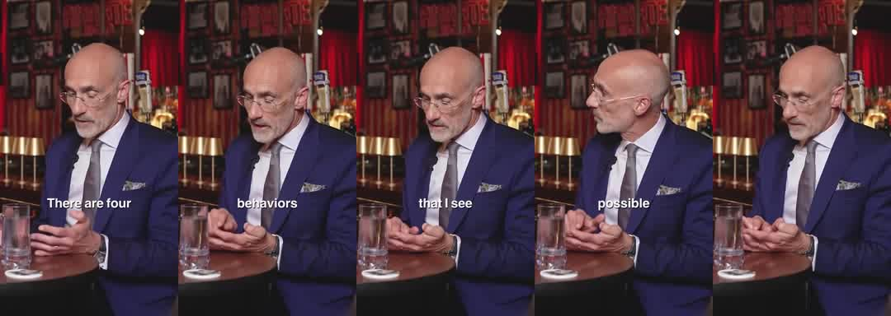

# v07_s02 · 01 Texto en pantalla (captions) · 3.4–6.9s (calidad 3)

- **Guion:** There are four behaviors that I see of the happiest possible people.
- **Qué se ve:** A-roll plano medio lateral (3/4) de Brooks sentado en la mesa alta del bar con una jarra de agua, gesticulando con las manos.
- **Diseño:** Caption sans bold (Helvetica/Inter Bold) blanca, 1–3 palabras, centrada horizontalmente a ~64% de la altura (sobre el pecho/manos). Sin caja, con sombra suave.
- **Efectos:** Bokeh cálido del bar al fondo, sin efectos añadidos.
- **Animación:** Captions palabra a palabra/por pares que se reemplazan (sin acumulación), cambio seco.
- **Por qué aquí:** Anuncio del contenido: cara del speaker, que es quien da autoridad.
