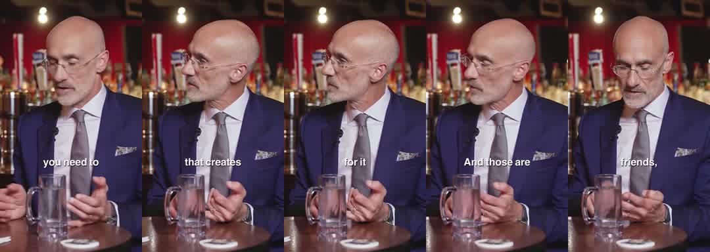

# v07_s09 · 01 Texto en pantalla (captions) · 38.5–47.7s (calidad 3)

- **Guion:** you need to believe that you're doing something that creates value and you're being recognized for it and that you're serving other people. And those are the big four, faith, family, friends and work.
- **Qué se ve:** Plano frontal medio largo, Brooks con las manos sobre la mesa, mirando abajo al resumir.
- **Diseño:** Caption sans bold blanco; en el resumen 'the big four,' y 'friends,' una palabra por vez.
- **Efectos:** Ninguno.
- **Animación:** Plano sostenido ~9 s; solo cambian los captions.
- **Por qué aquí:** Resumen de los 4: plano estable para que el espectador se concentre en las palabras.
