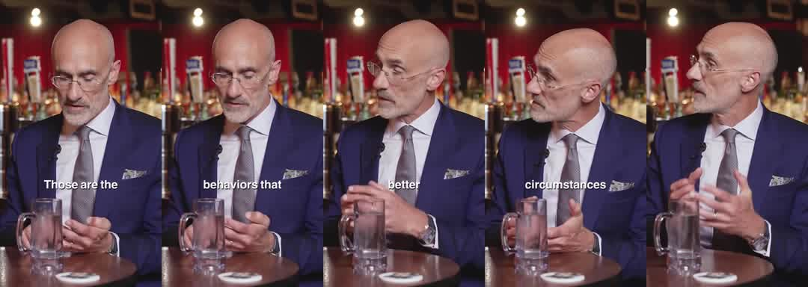

# v07_s10 · 01 Texto en pantalla (captions) · 47.7–50.5s (calidad 2)

- **Guion:** Those are the behaviors that will give you better circumstances
- **Qué se ve:** Alternancia lateral/frontal de cámara cada ~1.5 s.
- **Diseño:** Caption sans bold blanco.
- **Efectos:** Ninguno.
- **Animación:** Cortes de cámara más frecuentes hacia el final (aceleración).
- **Por qué aquí:** Sube el ritmo para el cierre.
