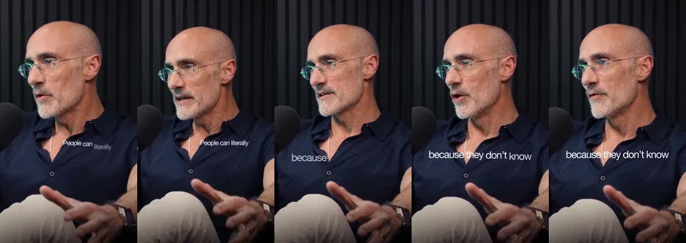

# v08_s01 · 01 Texto en pantalla (captions) · 0.0–3.1s (calidad 3)

- **Guion:** People can literally get divorced because they don't know that
- **Qué se ve:** A-roll: Brooks en plano medio-corto de 3/4, polo azul marino, gafas, fondo de cortina acústica negra con listones; gesticula con la mano.
- **Diseño:** Caption sans REGULAR (no bold, tipo Inter/Helvetica) blanca pequeña, 2–4 palabras, a la altura del pecho (~60–65% altura) ligeramente a la derecha del centro; palabras pendientes en gris ('know').
- **Efectos:** Sin efectos; look frío y oscuro del estudio.
- **Animación:** Write-on por palabra: cada palabra aparece en gris y se aclara a blanco (~0.15 s).
- **Por qué aquí:** Hook con cara: frase fuerte ('literalmente divorciarse') dicha por el experto.
