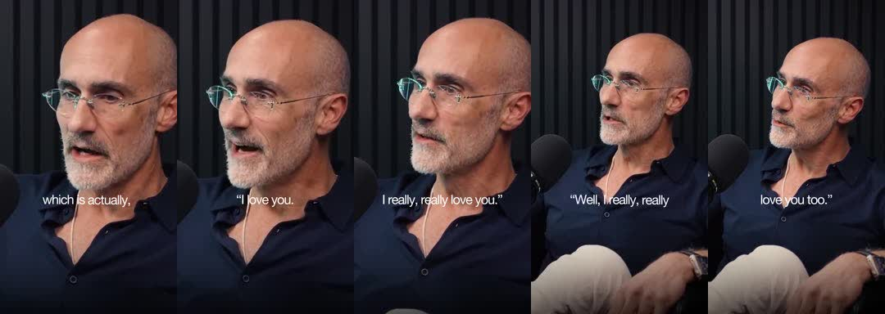

# v08_s20 · 01 Texto en pantalla (captions) · 41.6–47.6s (calidad 4)

- **Guion:** which is actually, I love you. I really, really love you. Really? Well, I really, really love you too.
- **Qué se ve:** A-roll: primer plano/plano medio de Brooks interpretando el diálogo, con un punch-in.
- **Diseño:** Captions sans regular blanca pequeña ENTRE COMILLAS curvas (“I love you.” / “Really!” / love you too.”), a la altura de la boca/barba.
- **Efectos:** Ninguno.
- **Animación:** Write-on; punch-in al cambiar de 'personaje' del diálogo.
- **Por qué aquí:** Dramatiza un diálogo con la cara: las comillas indican que actúa la frase.
