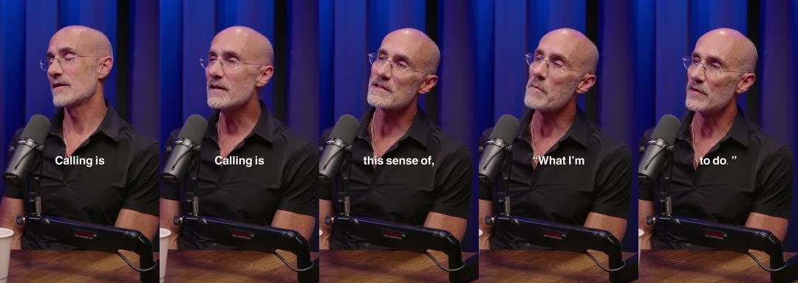

# v09_s02 · 01 Texto en pantalla (captions) · 3.1–5.6s (calidad 3)

- **Guion:** Calling is this sense of what I'm meant to do.
- **Qué se ve:** Brooks en plano medio (polo negro, micro de brazo a la izquierda, mesa de madera), fondo de cortinas azules.
- **Diseño:** Caption sans bold (Inter/Helvetica Bold) blanca pequeña, 1–2 palabras, centrada a ~56% de la altura (pecho). Tamaño pequeño respecto al frame (captions discretos).
- **Efectos:** Ninguno; set azul saturado con luz cálida en la piel.
- **Animación:** Captions que se reemplazan palabra/par a palabra, corte seco.
- **Por qué aquí:** Definición del concepto en la cara del experto.
