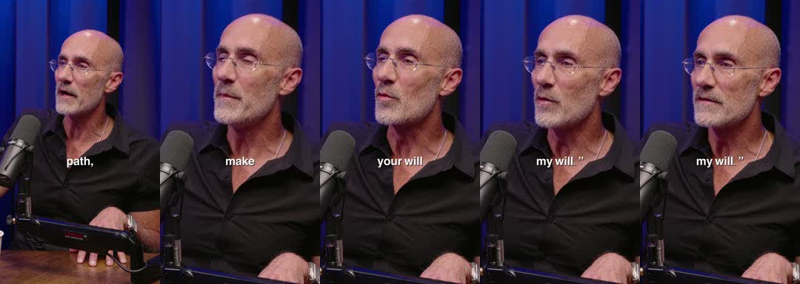

# v09_s05 · 01 Texto en pantalla (captions) · 11.6–13.3s (calidad 3)

- **Guion:** Make your will my will.
- **Qué se ve:** Primer plano cerrado (cabeza grande, micro en primer término).
- **Diseño:** Caption sans bold blanco con comilla de cierre ('my will. ”') porque es una oración citada.
- **Efectos:** Ninguno.
- **Animación:** Punch-in en la cita.
- **Por qué aquí:** La oración citada se enfatiza con plano cerrado y comillas.
