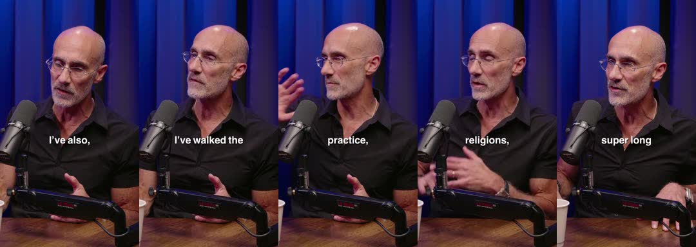

# v09_s06 · 01 Texto en pantalla (captions) · 13.3–23.8s (calidad 2)

- **Guion:** I've also, to find my calling, I've walked the Camino de Santiago, which is ancient practice, not just for Catholics, but for all religions. When you don't know what to do, go for a super long walk.
- **Qué se ve:** Plano medio sostenido ~10 s, Brooks gesticula hacia la entrevistadora.
- **Diseño:** Caption sans bold blanco 1–2 palabras ('I've walked the', 'de Santiago', 'Catholics,', 'super long').
- **Efectos:** Ninguno.
- **Animación:** Solo cambian los captions.
- **Por qué aquí:** Historia personal contada de corrido: plano estable para no romper la narración.
