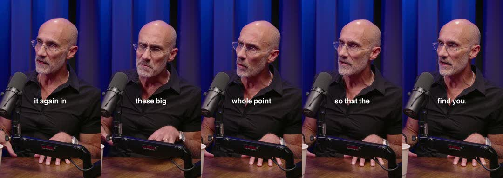

# v09_s10 · 01 Texto en pantalla (captions) · 38.5–47.0s (calidad 3)

- **Guion:** Did it again in 2021 when I have these big intentions and these big questions. But the whole point is that you need openness so that the answers can actually find you.
- **Qué se ve:** Plano medio con manos y micro visibles.
- **Diseño:** Caption sans bold blanco ('2021,', 'intentions', 'whole point', 'openness', 'answers can').
- **Efectos:** Ninguno.
- **Animación:** Punch-out; plano sostenido.
- **Por qué aquí:** La moraleja (apertura) se da en plano estable.
