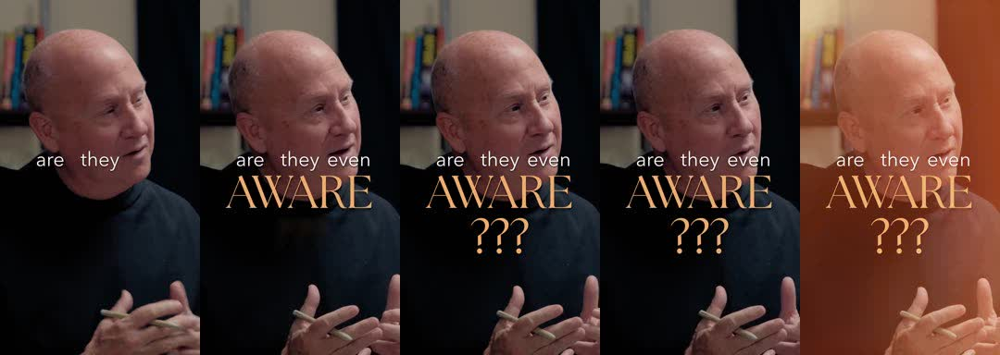

# v11_s06 · 01 Texto en pantalla (captions) · 6.0–6.8s (calidad 5)

- **Guion:** are they even aware?
- **Qué se ve:** Sobre el mismo primer plano del entrevistador (gesticulando con un bolígrafo) aparece un bloque tipográfico grande: 'are they even' / 'AWARE' / '???'.
- **Diseño:** 'are they even' en sans fina blanca con tracking amplio, tamaño caption ×1.3; 'AWARE' serif de alto contraste en MAYÚSCULAS (tipo Playfair/Bodoni ligera), ~4× el caption, color dorado-melocotón en degradado (#F3C9A0→#E39A5C); '???' en la misma serif dorada debajo. Bloque centrado a ~45–65 % de altura.
- **Efectos:** Degradado dorado en el texto, ligera sombra difusa para separarlo del fondo; sin caja.
- **Animación:** Palabras aparecen una a una sincronizadas a la voz ('are' → 'they' → 'even'), 'AWARE' entra con fade+leve escala (~0.2 s), '???' justo después. Suave.
- **Por qué aquí:** Es LA pregunta del video: se tipografía en grande para convertirla en titular y en hook visual. Cambio de sans a serif dorada = momento emocional/importante.
