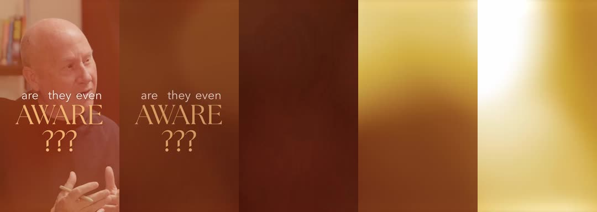

# v11_s07 · 01 Texto en pantalla (captions) · 6.8–7.3s (calidad 4)

- **Guion:** —
- **Qué se ve:** Transición: light leak ámbar-dorado a pantalla completa con la palabra 'AWARE' en serif dorada fantasma flotando sobre el destello.
- **Diseño:** 'AWARE' serif MAYÚSCULAS dorada semitransparente centrada a ~50 %; fondo #C99135→#924D24.
- **Efectos:** Film burn / light leak naranja-dorado, sobreexposición, blur.
- **Animación:** El texto se queda mientras el destello barre la pantalla (~0.45 s) y se desvanece: transición 'quemada' suave.
- **Por qué aquí:** Deja respirar la pregunta (pausa en el audio) y la sella visualmente antes de un cambio de bloque (créditos).
