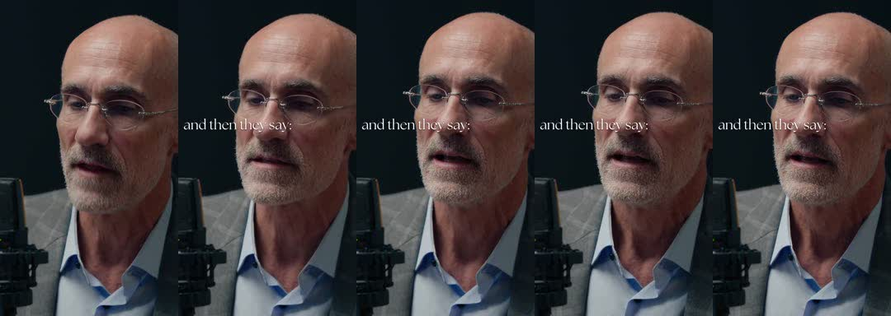

# v11_s13 · 01 Texto en pantalla (captions) · 18.2–19.7s (calidad 4)

- **Guion:** And then they say,
- **Qué se ve:** Brooks en primer plano cerrado (cara grande, gafas), mirando a la izquierda; texto 'and then they say:' a media altura a la izquierda.
- **Diseño:** Serif fina regular blanca (tipo Cormorant), tamaño ~1.3× caption, alineada a la izquierda en ~47 % de altura, superpuesta a la cara.
- **Efectos:** Grade cálido; leve sombra en el texto.
- **Animación:** Write-on palabra a palabra con fade; prepara el sitio para la palabra grande que viene.
- **Por qué aquí:** Construye suspense: el texto anuncia la cita ('they say:') y deja hueco a la derecha para el golpe.
