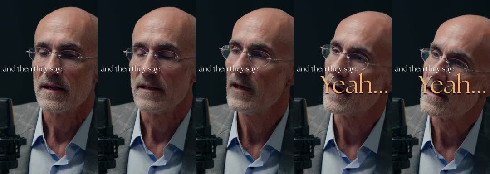

# v11_s14 · 01 Texto en pantalla (captions) · 19.7–20.5s (calidad 5)

- **Guion:** yeah.
- **Qué se ve:** Aparece 'Yeah...' gigante en serif dorada sobre el primer plano de Brooks, debajo de 'and then they say:'.
- **Diseño:** Serif alto contraste ligera (tipo Playfair), ~5× caption, degradado dorado-melocotón (#F5D3A8→#E3A36A), alineada a la derecha/centro en ~50 % de altura, desbordando casi el ancho.
- **Efectos:** Degradado en relleno, sombra difusa muy suave.
- **Animación:** Fade + escala ligera (0.95→1.0) en ~0.25 s, sincronizado exacto con 'yeah'.
- **Por qué aquí:** Remate emocional: la respuesta devastadora de los jóvenes se convierte en titular. Cambio a serif dorada = 'esto importa'.
