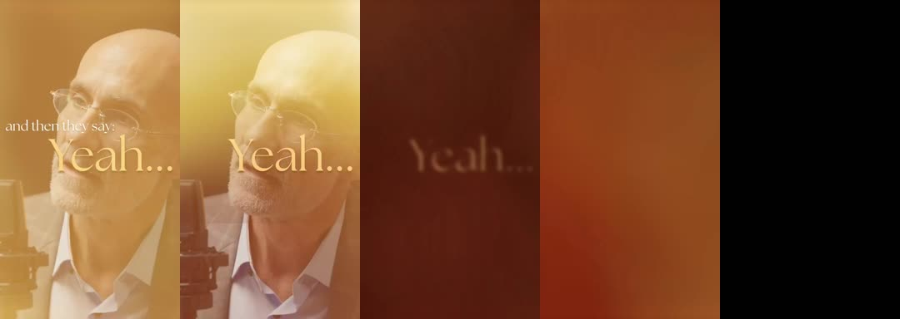

# v11_s15 · 01 Texto en pantalla (captions) · 20.5–21.1s (calidad 4)

- **Guion:** —
- **Qué se ve:** Light leak dorado-blanco que quema la imagen dejando ver 'Yeah...' fantasma, y se funde a un fondo marrón-rojizo oscuro.
- **Diseño:** Paleta #F5E7C0 → #924D24 → #4A1E10.
- **Efectos:** Film burn / light leak, sobreexposición, blur intenso.
- **Animación:** Transición de ~0.6 s: destello que entra por la izquierda, satura a blanco y cae a marrón oscuro.
- **Por qué aquí:** Pausa emocional tras el 'yeah' (silencio en el audio): deja que el golpe aterrice y separa capítulos.
