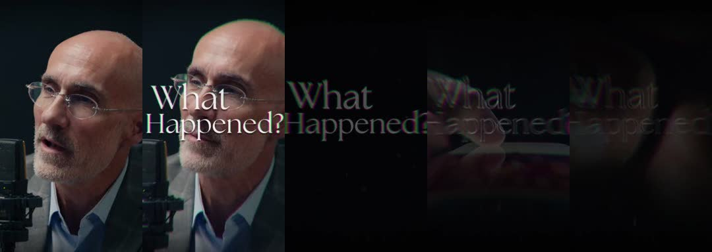

# v11_s25 · 01 Texto en pantalla (captions) · 48.4–50.3s (calidad 5)

- **Guion:** What happened?
- **Qué se ve:** Primer plano muy cerrado de Brooks con 'What / Happened?' enorme a la izquierda; luego todo se desenfoca y oscurece quedando el texto fantasma.
- **Diseño:** Serif alto contraste ligera blanca, ~4× caption, alineada a la izquierda a ~45–55 % de altura, dos líneas.
- **Efectos:** Aberración cromática (separación RGB) en el texto y la imagen, glow, después blur fuerte y oscurecimiento.
- **Animación:** Push-in lento sobre la cara; 'What' entra, 'Happened?' después; a 49.5 s blur + dim a casi negro (~0.6 s).
- **Por qué aquí:** Pregunta retórica que abre el giro del video: se tipografía como titular y el blur-to-dark crea el 'cliffhanger' antes de la respuesta espiritual.
