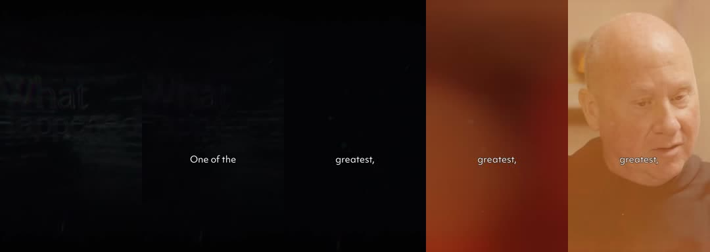

# v11_s26 · 01 Texto en pantalla (captions) · 50.3–51.1s (calidad 4)

- **Guion:** One of the greatest,
- **Qué se ve:** Light leak naranja-rojizo y luego dorado-blanco; caption 'greatest,' en el centro.
- **Diseño:** Paleta #924D24 → #E4C478 → #FBFAF6; caption sans fina blanca ~63 %.
- **Efectos:** Film burn / light leak.
- **Animación:** Transición de luz ~0.6 s en dos pulsos (rojo → dorado).
- **Por qué aquí:** Cambio de hablante (de Brooks al sacerdote) y de tono (de datos a lo espiritual): la luz cálida actúa como 'revelación'.
