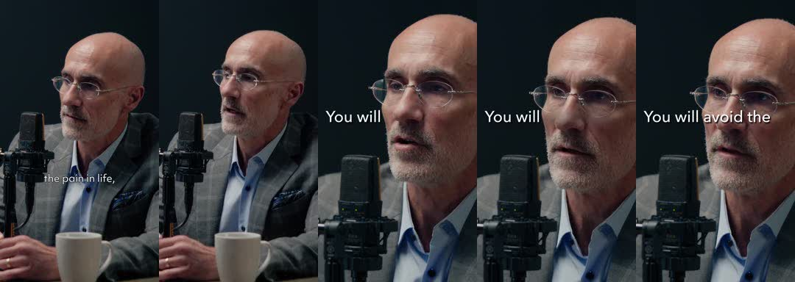

# v11_s30 · 01 Texto en pantalla (captions) · 67.4–68.9s (calidad 5)

- **Guion:** you will avoid the
- **Qué se ve:** Primer plano cerrado de Brooks; a la izquierda aparece 'You will avoid the' y debajo 'Meaning'.
- **Diseño:** 'You will avoid the' sans geométrica medium blanca (~1.8× caption), alineada a la izquierda a ~45 %; 'Meaning' serif ligera con degradado dorado-melocotón ~2.5× debajo.
- **Efectos:** Sombra suave.
- **Animación:** Write-on palabra a palabra sincronizado; 'Meaning' con fade+escala.
- **Por qué aquí:** La frase-tesis del video se escribe palabra a palabra para que el espectador la lea con él; la palabra clave en serif dorada.
