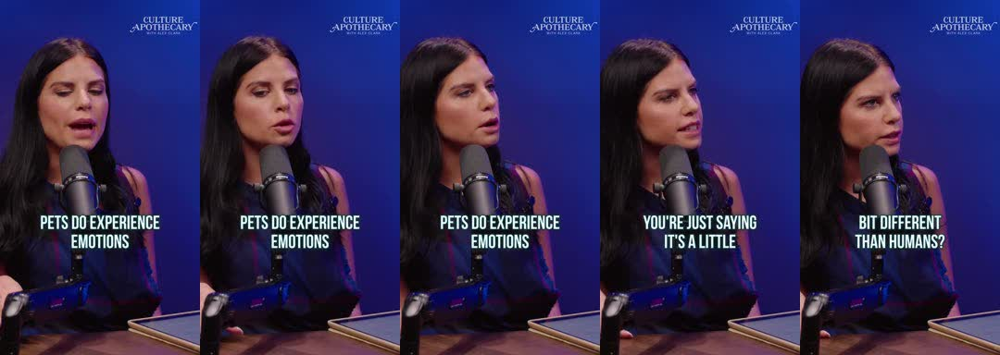

# v13_s01 · 01 Texto en pantalla (captions) · 0.0–3.9s (calidad 3)

- **Guion:** Pets do experience emotions. You're just saying it's a little bit different than humans.
- **Qué se ve:** Presentadora (pelo negro, top oscuro) en plano medio corto con micro de podcast, fondo de cortina azul iluminada; logo 'CULTURE APOTHECARY with Alex Clark' arriba a la derecha.
- **Diseño:** Captions sans condensada bold MAYÚSCULAS (tipo Bebas/Oswald/Anton), blanca, 2 líneas de 2–3 palabras, centrada a ~63–66 % de altura, ~6 % del alto por línea. Logo serif blanca pequeña arriba-derecha (~8 % ancho). Fondo cortina azul #1E2E9A con luz violeta.
- **Efectos:** Sombra negra dura/difusa bajo el caption para legibilidad; grade saturado de estudio (azules y piel cálida).
- **Animación:** Caption cambia por bloques de frase (corte seco, sin animación de entrada visible). Plano fijo.
- **Por qué aquí:** Hook: afirmación polémica dicha por la presentadora + caption grande que se lee sin sonido.
