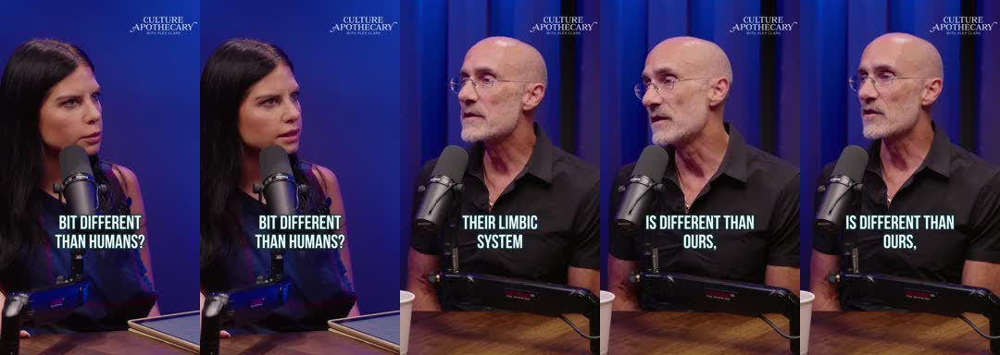

# v13_s02 · 01 Texto en pantalla (captions) · 3.9–5.9s (calidad 2)

- **Guion:** Their limbic system is different than ours,
- **Qué se ve:** Brooks en plano medio, camisa negra, micro delante, cortina azul detrás, mirando a la presentadora.
- **Diseño:** Caption condensada bold MAYÚSCULAS blanca ~63 %; logo arriba-derecha.
- **Efectos:** Sombra bajo caption, grade de estudio azul.
- **Animación:** Corte seco al experto.
- **Por qué aquí:** La respuesta experta = cara del experto.
