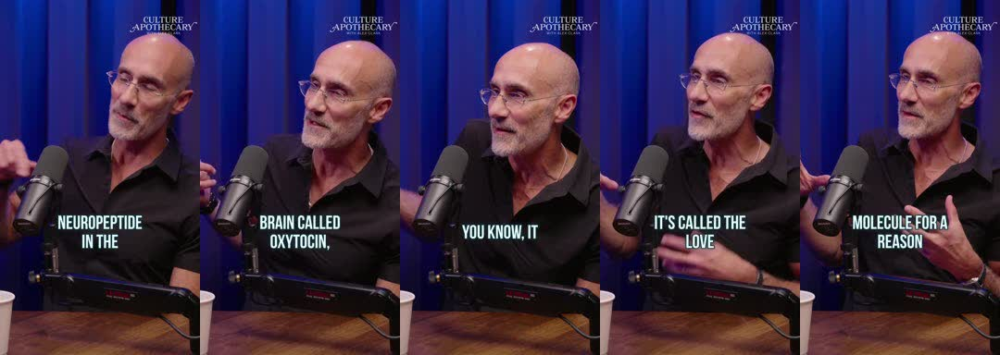

# v13_s04 · 01 Texto en pantalla (captions) · 7.3–13.3s (calidad 2)

- **Guion:** Neuropeptide in the brain called oxytocin. Of course, you know it. It functions as a hormone. It's called the love molecule for a reason.
- **Qué se ve:** Brooks plano medio desde un ángulo más lateral, gesticulando, sonriendo.
- **Diseño:** Caption condensada bold MAYÚSCULAS blanca ~63 % ('BRAIN CALLED OXYTOCIN,', 'MOLECULE FOR A REASON').
- **Efectos:** Grade de estudio.
- **Animación:** Plano largo (~6 s); captions por bloques de 2–4 palabras.
- **Por qué aquí:** Explicación del concepto (oxitocina); no hay gráfico: el editor confía en el A-roll y el caption.
