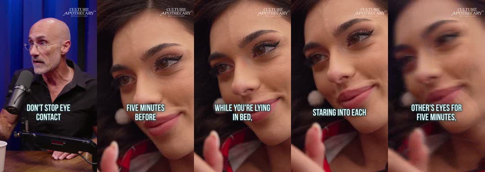

# v13_s07 · 01 Texto en pantalla (captions) · 19.0–25.0s (calidad 3)

- **Guion:** Five minutes before you go to sleep at night while you're lying in bed staring to each other's eyes for five minutes,
- **Qué se ve:** Presentadora en primerísimo primer plano (cámara lateral cerrada), sonriendo y escuchando, mano cerca de la cara.
- **Diseño:** Caption condensada bold MAYÚSCULAS blanca ~65 %.
- **Efectos:** Fondo muy desenfocado, piel cálida.
- **Animación:** Corte; ligera deriva de cámara.
- **Por qué aquí:** Plano de reacción (escucha) mientras Brooks da la instrucción: conexión emocional y respiro.
