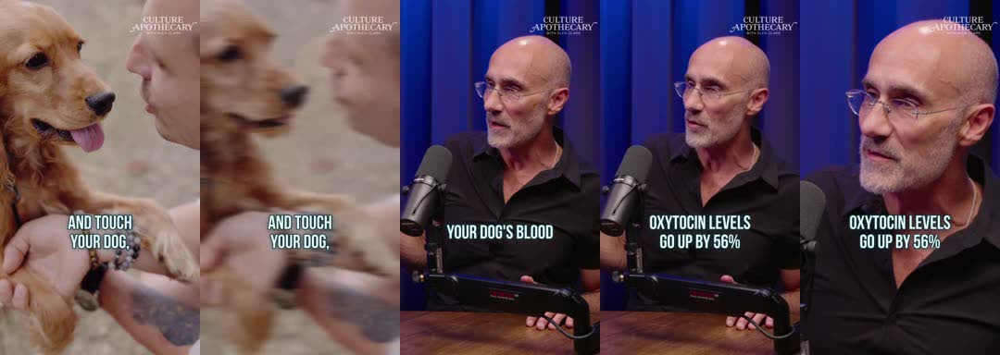

# v13_s12 · 01 Texto en pantalla (captions) · 41.6–45.4s (calidad 2)

- **Guion:** your dog's blood oxytocin levels go up by 56%. Wow.
- **Qué se ve:** Brooks plano medio (entra con fundido del perro, tinte azulado), dice el dato.
- **Diseño:** Caption 'OXYTOCIN LEVELS GO UP BY 56%' en el mismo estilo (sin gráfico aparte); 'WOW' de la presentadora en una sola línea.
- **Efectos:** Fundido cruzado, grade de estudio.
- **Animación:** Dissolve ~0.4 s.
- **Por qué aquí:** El dato se deja en el caption: el formato es crudo y no añade gráficos (oportunidad perdida de graph_stats).
