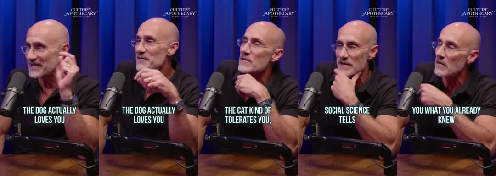

# v13_s15 · 01 Texto en pantalla (captions) · 52.2–57.4s (calidad 2)

- **Guion:** You know, the dog actually loves you. The cat kind of tolerates you, which is, once again, social science tells you what you already knew.
- **Qué se ve:** Brooks plano medio, mano en la barbilla, gesto irónico.
- **Diseño:** Caption ~65 % ('THE DOG ACTUALLY LOVES YOU', 'SOCIAL SCIENCE TELLS').
- **Efectos:** Grade de estudio.
- **Animación:** Plano fijo; termina en seco sin end card.
- **Por qué aquí:** Cierre con remate y la frase-sentencia del experto en cara.
