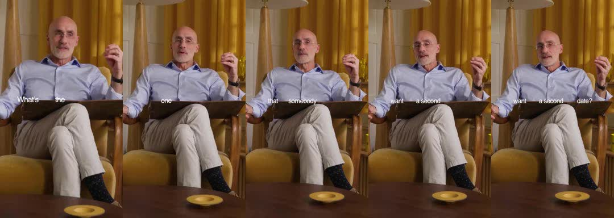

# v16_s01 · 01 Texto en pantalla (captions) · 0.0–2.6s (calidad 4)

- **Guion:** What's the number one predictor, that somebody doesn't want a second date?
- **Qué se ve:** A-roll plano general: Arthur Brooks sentado en butaca mostaza, piernas cruzadas, cortinas doradas detrás, mesita con plato dorado en primer término. Captions palabra a palabra en el centro ('one', 'predictor', 'want a second date?').
- **Diseño:** Sans grotesca blanca (tipo Inter/SF Pro Semibold) pequeña (~3 % altura), palabras separadas horizontalmente siguiendo el ritmo; centro de la pantalla (~45 % altura). Paleta cálida ámbar #75490F/#4A2C14 + camisa azul.
- **Efectos:** Grading cálido cinematográfico, profundidad de campo baja; viñeta inferior oscura (gradiente a negro en el tercio bajo).
- **Animación:** Palabras aparecen una a una con fade+pop muy corto (~0.1 s); sin movimiento de cámara.
- **Por qué aquí:** Hook con pregunta directa + cara del speaker: la pregunta genera curiosidad (¿cuál es?) y el plano general establece autoridad (entrevista seria).
