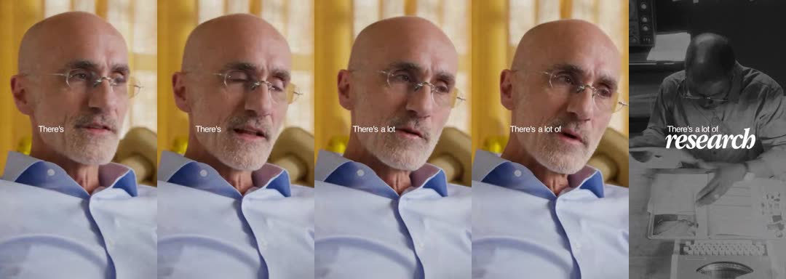

# v16_s02 · 01 Texto en pantalla (captions) · 2.6–3.1s (calidad 3)

- **Guion:** There's a lot
- **Qué se ve:** Primer plano del speaker (otra cámara, 3/4), caption 'There's a lot' pequeño al centro.
- **Diseño:** Misma sans blanca pequeña, centro.
- **Efectos:** Grading cálido, fondo desenfocado.
- **Animación:** Corte de cámara (cambio de tamaño de plano) a ritmo de frase; texto pop.
- **Por qué aquí:** Cambio de plano tras la pregunta para relanzar la atención antes del dato.
