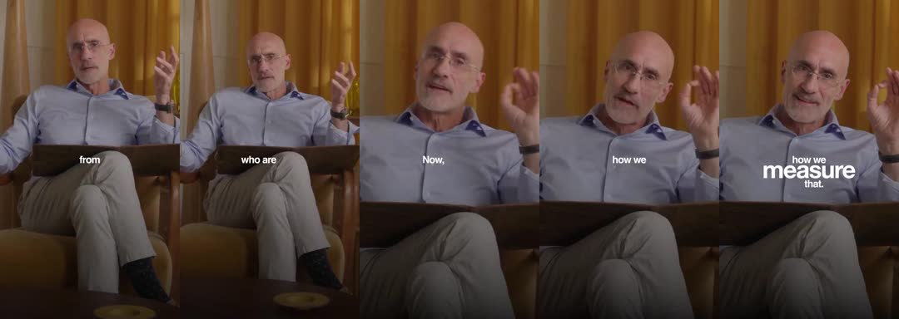

# v16_s07 · 01 Texto en pantalla (captions) · 8.4–11.0s (calidad 3)

- **Guion:** people who are dating. Now, here's how we measure that.
- **Qué se ve:** A-roll plano medio del speaker gesticulando; caption 'Now,' pequeño.
- **Diseño:** Sans blanca pequeña centro.
- **Efectos:** Grading cálido.
- **Animación:** Corte; texto palabra a palabra.
- **Por qué aquí:** Vuelta a la cara para anunciar algo nuevo ('here's how we measure that') → regla: anunciar = cara.
