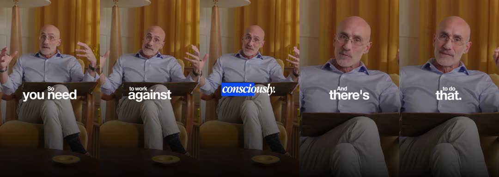

# v16_s12 · 01 Texto en pantalla (captions) · 21.9–25.6s (calidad 4)

- **Guion:** you need to work against it consciously. And there's a way to do that.
- **Qué se ve:** A-roll (zoom a medio) del speaker; 'consciously.' en serif itálica blanca sobre caja azul resaltada; 'to work' + 'against' + 'it'; 'And' + 'there's'.
- **Diseño:** Caption normal: sans bold blanca, palabra clave ~2.5x. Palabra especial: serif itálica blanca sobre rectángulo azul #1E5BFF (highlight box). Centro (~50 % altura).
- **Efectos:** Grading cálido; viñeta inferior.
- **Animación:** Caja azul se expande horizontalmente detrás de la palabra (wipe ≈0.15 s).
- **Por qué aquí:** Palabra-instrucción ('consciously') marcada con el color del sistema minimal: une A-roll y gráficos.
