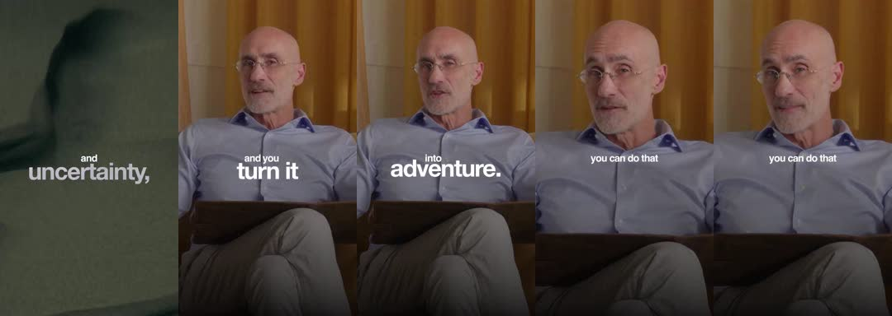

# v16_s16 · 01 Texto en pantalla (captions) · 28.8–32.3s (calidad 4)

- **Guion:** and you turn it into adventure. And you can do that because
- **Qué se ve:** A-roll primer plano del speaker sonriendo; 'into' + 'adventure.' grande; 'you can do that'.
- **Diseño:** Sans bold blanca, clave ~3x; centro.
- **Efectos:** Cálido.
- **Animación:** Corte a la cara justo en 'adventure' (giro positivo).
- **Por qué aquí:** Giro de esperanza → vuelve la cara del speaker (conexión).
