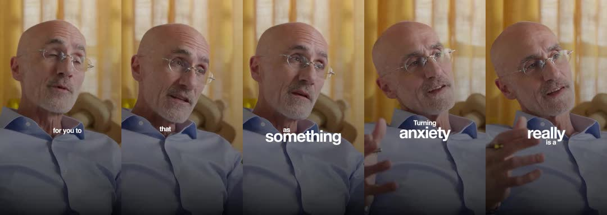

# v16_s18 · 01 Texto en pantalla (captions) · 35.0–41.4s (calidad 3)

- **Guion:** you to reframe that experience as something better. Turning anxiety into an adventure really is a two
- **Qué se ve:** Primer plano (y punch-ins) del speaker; captions 'for you to', 'that', 'as' + 'something', 'Turning' + 'anxiety', 'really' + 'is a'.
- **Diseño:** Sans bold blanca; patrón 'pequeña arriba + clave grande' o 'clave + pequeña abajo'; centro-bajo (~60 %).
- **Efectos:** Cálido, fondo desenfocado.
- **Animación:** Punch-ins de escala (zoom digital 110–120 %) cada 1.5–2 s para simular cambios de cámara.
- **Por qué aquí:** Explicación hablada larga: se sostiene con la cara y zooms rítmicos.
